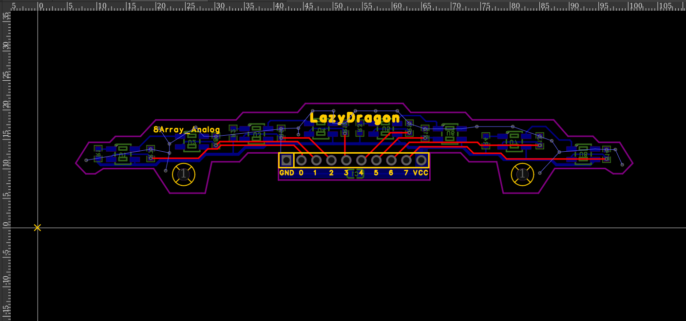

# LazyDragon Oculus-8 — Analog IR Sensor Array

The **LazyDragon Oculus-8 analog IR sensor array** is an 8-channel reflective
infrared line-sensor board with a fast, interrupt-driven reader for the
ATmega328P / Arduino Nano.

This page covers the hardware and the software at a glance. For the full
code walkthrough see [`MANUAL.md`](MANUAL.md); for troubleshooting see
[`DEBUG.md`](DEBUG.md).

---

## Hardware

**Board:** LazyDragon Oculus-8 analog IR sensor array (silkscreen: `8Array_Analog`)

| Spec | Value |
|------|-------|
| Sensor | 8x QRE1113GR reflective IR opto-sensor |
| Channels | 8 analog, mapped to `A0`..`A7` |
| Board size | 94.4 mm x 15.5 mm |
| Mounting holes | 2, spaced 57.4 mm apart |
| Interface | 10-pin header, labeled left to right: `GND  0  1  2  3  4  5  6  7  VCC` |

Each channel is a QRE1113GR: an infrared emitter paired with a
phototransistor. The emitter bounces IR off the surface below; the
phototransistor current rises when the surface is reflective and falls when it
is dark. The board exposes the eight raw analog signals directly, so all
thresholding and calibration happen in firmware.

- **`0`..`7`** map to Arduino `A0`..`A7`, with `A0` as the leftmost channel.
- **`GND` / `VCC`** power the board and the sensor LEDs.
- Wiring is symmetric; if the array is mounted mirrored, the firmware weights
  can simply be negated.

### Circuit

The eight sensors are treated as **four pairs**. Inside each pair the two
QRE1113GR infrared emitters are wired **in series**, driven through a single
**150 Ω** current-limiting resistor. Sharing one resistor across the pair
keeps the part count down and keeps both emitters in a pair at the same
brightness.

Each sensor's phototransistor output is read through its own **47 kΩ
resistor**, which turns the light-dependent current into a voltage the ADC can
measure. A single **100 nF decoupling capacitor** sits across the supply to
smooth the rail and keep switching noise out of the readings.

Mechanical drawings, assembly images, and the manufacturing package are in the
project's `assets/`, `datasheets/`, and `fabrication/` folders.

---

## Software

`code/oculus_8.ino` is a **sensor-reading and diagnostics
harness** — it reads the array and reports position and line status, but does
not drive motors. Feed its position output into your own PID loop.

All eight channels are scanned continuously in the background by the
ADC-complete interrupt. The main loop never waits on a conversion and never
calls `analogRead()`. At a /16 ADC prescaler a full 8-channel frame takes
well under 0.1 ms, leaving the CPU free for control and telemetry.

On boot the sketch asks you to sweep the array over the line for four
seconds; it then calibrates each channel individually and streams a telemetry
line over Serial at 115200 baud.

> **Important:** while this sketch owns the ADC, do **not** call
> `analogRead()` anywhere — it would fight the ISR over `ADMUX`/`ADCSRA` and
> corrupt the scan.

---

## Highlights

- **Fully non-blocking scanning.** The ADC runs one channel at a time from an
  interrupt; the main loop only ever reads a ready buffer.
- **Deterministic, jitter-resistant timing.** No blocking delays in the hot
  path, so loop period stays stable enough to feed a fast PID.
- **8 channels by default** (A0..A7), with symmetric weights for a clean
  centroid.
- **Integer-only position math.** Position is scaled x1000 into an `int16_t`
  (`-7000..+7000`), avoiding floating point in the loop for speed and
  reproducibility on an 8-bit core.
- **Per-channel auto-calibration.** Each sensor is normalized against its own
  observed min/max, so mismatched LED/phototransistor gain does not bias the
  result.
- **Pattern classification, not just a centroid.** The reader separates a
  clean single line from edge cases, forks, and line loss, giving higher-level
  logic the information it needs to react correctly.
- **Atomic snapshots.** A short critical section copies the ISR buffer so a
  half-updated frame can never be read.
- **Saturation detection.** Flags when any channel is pinned near the ADC
  rails, warning that the reading is electrically clipped and untrustworthy.
- **No motor movement required to calibrate.** Calibration simply observes a
  manual sweep; the board stays still and under your control.

---

## Documentation

- [`MANUAL.md`](MANUAL.md) — usage and code/function reference.
- [`DEBUG.md`](DEBUG.md) — expected behavior and troubleshooting.
- [`CHANGELOG.md`](CHANGELOG.md) — version history.
- [`COMMERCIAL-LICENSE.md`](COMMERCIAL-LICENSE.md) — commercial licensing and royalties.
- Schematic and BOM: [`assets/`](assets/)
- Manufacturing files (gerbers, drill): [`fabrication/`](fabrication/)

---

## License

This project is **source-available, not open source**.

- **Hardware** (PCB, schematic, assets) — [`LICENSE`](LICENSE) ·
  [CC BY-NC-SA 4.0](https://creativecommons.org/licenses/by-nc-sa/4.0/): free
  for personal and non-commercial use with attribution; commercial use requires
  a separate license.
- **Firmware** (`code/`) — [`LICENSE-CODE`](LICENSE-CODE) ·
  [PolyForm Noncommercial 1.0.0](https://polyformproject.org/licenses/noncommercial/1.0.0):
  free for non-commercial use.

**Commercial use requires a paid license** (royalty + attribution). See
[`COMMERCIAL-LICENSE.md`](COMMERCIAL-LICENSE.md) or contact
**contact@lazydragon.club**.

### No warranty

The design and firmware are provided **"as is", without warranty of any kind**.
LazyDragon Pvt Ltd is **not liable** for any damages arising from their use. You
use this project at your own risk; verify all safety and certification
requirements before any product use.

> These licenses are non-commercial, so this is **not** an OSI open-source or
> OSHWA-certified open-hardware release.
